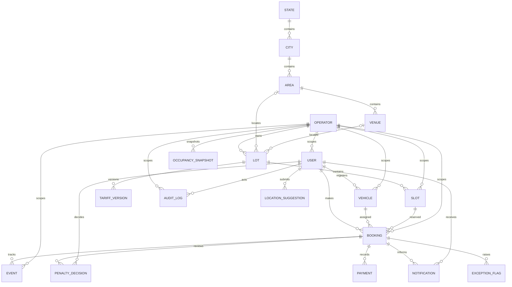

# Database ER outline

`STATE`, `CITY`, `AREA`, and `VENUE` are shared reference data and intentionally have no `operator_id`; a `LOCATION_SUGGESTION` is visible to its submitter and authorized managers only. Lots remain tenant-owned, with optional approved `area_id` and `venue_id` references. PostgreSQL `btree_gist` exclusion on `slot_id` and the half-open `tstzrange(starts_at, ends_at, '[)')` prevents overlaps while permitting back-to-back reservations. Active held, confirmed, and checked-in bookings participate in the exclusion.
